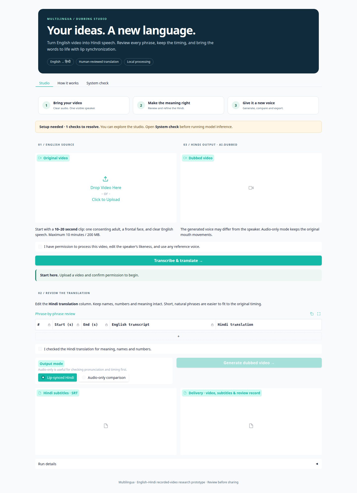

# Multilingua

**Reviewable English → Hindi video dubbing, with optional lip synchronization.**

Help an educator bring a short English explanation to Hindi-speaking learners. Upload a recorded video, review every translated phrase, generate speech that fits the original timing, and export a disclosed AI-dubbed video with subtitles and a review record.



> **Readiness:** the controller, media pipeline and local studio have automated validation. Full neural rehearsal and bilingual audiovisual approval are still required on the presentation workstation. Original demo videos and model weights were not committed and are currently inaccessible. No synthetic test output is presented as real Hindi speech or lip editing. See [validation](docs/VALIDATION.md).

## What it does

- Transcribes English speech with Whisper and translates it using IndicTrans2.
- Gives you a side-by-side Hindi review table with protected source text and timestamps.
- Generates a generic Hindi voice with Indic Parler-TTS, or a permitted reference voice through IndicF5.
- Fits speech to its time slot with at most 1.25× acceleration; rejects longer speech for revision.
- Optionally edits mouth movements with MuseTalk; audio-only comparison is an explicit mode.
- Exports MP4, Hindi SRT, reviewed text, timing measurements, provenance and a ZIP delivery.
- Retains the previous successful output and matching metadata if a later render fails.

**Scope:** one visible consenting adult, clear English audio, frontal face, recorded clips up to 10 minutes. Start with 10–20 seconds. Background music is not retained. The studio focuses on recorded Hindi dubbing. The repository also includes an experimental local capture service and causal file replay. Both process complete clips or chunks. Multiple speakers and continuous WebRTC calls remain outside scope.

## Open the studio

```bash
git clone https://github.com/mauryaakash-ai/Multilingua.git
cd Multilingua
# Ubuntu prerequisite: sudo apt install ffmpeg python3-venv
python3 -m venv .venv
source .venv/bin/activate
pip install -e '.[ui]'
python -m multilingua.cli ui
```

Open **http://127.0.0.1:7860**. The UI opens before models are configured and shows actionable setup guidance. Neural inference requires separate environments, model downloads/access and the configured GPU pipeline. Follow [setup](docs/SETUP.md), copy `configs/local.example.json` to `configs/local.json`, then run:

```bash
python -m multilingua.cli --config configs/local.json doctor
python -m multilingua.cli --config configs/local.json ui
```

The default uses a generic voice without a reference WAV. `configs/reference-voice.example.json` documents the optional IndicF5 route. Configuration supports `{project}`, `{python}`, `~` and environment-variable paths. Local configs, weights, private media and runs stay out of Git.

## CLI workflow

```bash
python -m multilingua.cli --config configs/local.json prepare /absolute/input.mp4
# Edit Hindi translations in the printed job's segments.json.
python -m multilingua.cli --config configs/local.json render runs/JOB_ID --audio-only
python -m multilingua.cli --config configs/local.json render runs/JOB_ID
```

Outputs live under `runs/JOB_ID/renders/RENDER_ID/`; top-level output aliases point through the atomic `current` link. Download `delivery.zip` for video, captions, review text, alignment, provenance and disclosure together. Watch and listen to the entire result before sharing, and label the clip **AI-dubbed**.

## Quick Webcam

Open **Quick Webcam** in the local studio, confirm permission, record up to 15 seconds of English, then press **Stop**. Hindi text, subtitles, and an audio preview arrive first. With **Synchronize lips to the Hindi dub** enabled, a MuseTalk render replaces the preview when it finishes. Keep one face visible throughout the clip. If lip sync stops, the audio preview remains available. Use **Studio** to review and edit the translation phrase by phrase before rendering.

## Experimental capture and evaluation

A separate authenticated FastAPI service can record or upload short clips for background dubbing. It supports optional resident workers, MuseTalk or LatentSync, and experimental Tamil and Telugu presets. Use the Hindi review studio for the classroom walkthrough. See [service setup](docs/SETUP.md#experimental-local-capture-service) and [prior experimental results](docs/EVALUATION_REPORT.md).

## Project submission

| Rubric item | Document / evidence |
|---|---|
| Use case and functionality | This README + [design: users and scope](docs/DESIGN.md) |
| Eight-part design document | [Design and architecture](docs/DESIGN.md) |
| Architecture diagram | [Diagram](docs/assets/architecture.svg) + Mermaid in design document |
| Tech stack and third-party dependencies | [Technology register](docs/TECH_STACK.md) |
| Evaluation slices, metrics and launch thresholds | [Evaluation plan](docs/EVALUATION.md) + [scorecard](examples/review-scorecard.csv) |
| Actual checks and unresolved gaps | [Current validation](docs/VALIDATION.md) |
| 15-minute overview, demo and audience Q&A | [November 18 runbook](docs/DEMO.md) |
| Repository-wide findings and fixes | [Audit and rubric mapping](docs/AUDIT.md) |
| Future work and scope | [Roadmap](docs/COMPLETION_PLAN.md) |

## Checks

```bash
pip install -e '.[ui,server,dev]'
ruff check .
ruff format --check .
python -m unittest discover -s tests -v
python tests/browser_smoke.py
python -m build
```

Tests use real FFmpeg with fixed-text/tone **test doubles**. They verify software behavior, not neural quality. The browser test needs Chrome or Playwright Chromium. Heavy model environments are intentionally excluded from CI.

## Repository map

`multilingua/`: controller, UI, media and replay · `adapters/`: isolated model entry points and protocol · `configs/`: portable examples and environment records · `tests/`: regressions and browser smoke · `docs/`: submission package · `examples/`: evaluation templates.

## Responsible use and license

Use only permitted video, likeness and reference voices. The app is a local single-user research tool, bound to localhost with no public share link. Model downloads may contact upstream hosts during setup; provided inference adapters process media locally. Runs remain on disk until you delete them. Shared output must retain AI-editing disclosure; this prototype does not verify consent or watermark pixels.

Project code is [MIT](LICENSE). Upstream code, weights, datasets and voices retain their own terms; see the [dependency register](docs/TECH_STACK.md). Never commit access tokens, private recordings or consent records.
