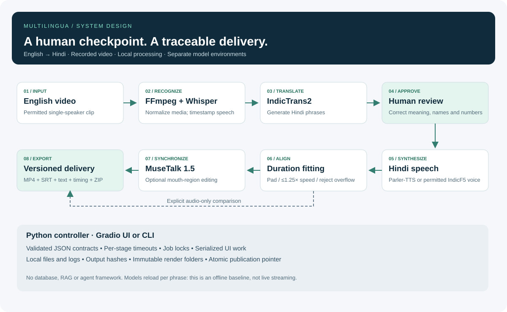

# Multilingua — GenAI lab submission

**Demo date:** 18 November 2026  
**Scope:** English → Hindi recorded-video dubbing only  
**GitHub:** https://github.com/mauryaakash-ai/Multilingua

## Project overview

An educator uploads a permitted English explanation, checks the generated Hindi translation, and produces a Hindi-dubbed video with optional lip synchronization. A learner can listen in Hindi while following the original visual material. The output includes Hindi subtitles and a traceable record of reviewed text, timing and model processing.

The workflow is **upload → permission → English transcription → Hindi translation → human review → Hindi speech → timing preflight → optional lip editing → playback and export**. Hindi speech must fit the original video duration. The system caps acceleration at 1.25× and reports unresolved timing failures rather than silently cutting speech. A failed rerender preserves the previous successful result.

This is a local GPU research prototype, not continuous realtime dubbing. It uses pretrained models; the team contributes the review workflow, model integration, timing controls, failure handling, versioned artifacts and evaluation tooling. No model training, RAG, database or agent framework is claimed.

## Where each submission requirement is covered

| Lab requirement | Submission evidence |
|---|---|
| 1. GitHub code and shareable repository link | Repository link above; [README and commands](README.md) |
| 2. Use case and overall functionality | Overview above; [users and success criteria](docs/DESIGN.md#1-problem-users-and-success) |
| 3. High-level architecture and interactions | [Eight-part design](docs/DESIGN.md), its Mermaid diagram, and [projection-ready SVG](docs/assets/architecture.svg) |
| 4. Technology stack | [Technology and dependency register](docs/TECH_STACK.md), including language, UI, model roles, persistence and licensing |
| 5. Overview followed by working examples | [Demo runbook](docs/DEMO.md): three English scripts, draft Hindi references, presentation timing and Q&A |

## Design template coverage

| Required section | Location and main decision |
|---|---|
| Problem and users | Design §1: educators and Hindi-speaking learners; preserve meaning and disclose AI editing |
| Why GenAI and which kind | Design §2: pretrained task-specific generation; voice prompting; no RAG or fine-tuning; subtitles and audio-only baselines |
| Scope | Design §3: English input, Hindi output, one visible permitted speaker, recorded clips; explicit boundary failures |
| Requirements | Design §4: testable F1–F9 and N1–N9, with targets distinguished from measured results |
| Architecture | Design §5: component flow, review checkpoint, media timing, worker processes, state and export |
| Failure modes and guardrails | Design §6: incorrect words, timing overflow, face artifacts, OOM, stale output and misuse; residual risks retained |
| Evaluation plan | Design §7 and [evaluation plan](docs/EVALUATION.md): test slices, per-stage metrics, human rubric and release gates |
| Open questions and risks | Design §8: rehearsal, model rights, quality, compute and the course's exact five criteria |

The supplied guidelines mention “five criteria” without defining them. Design §2 labels its five criteria as a working interpretation, not an instructor-approved framework.

## Architecture at a glance

Python orchestrates FFmpeg, faster-whisper `small.en`, IndicTrans2 and Indic Parler-TTS. Hindi audio drives MuseTalk 1.5 or LatentSync 1.6. IndicF5 is an optional permitted-reference voice route. GFPGAN restoration is an optional recorded-output experiment, OFF by default; natural-looking lips are not guaranteed. Gradio provides the review studio; an experimental FastAPI interface captures/uploads complete clips. Files, JSON and ZIP provide persistence; no database or agentic framework is required.

## Demonstration and evidence

1. Introduce the learner use case and show the GitHub link.
2. Explain the architecture and why Hindi review precedes synthesis.
3. Use a permitted 10–20 second English recording. Show transcription, edit Hindi, approve, and generate.
4. Play original, audio-only and lip-edited versions from the same reviewed text; show the exported subtitles and provenance.
5. Show one timing failure and its recovery, then separate measured software behavior from model-quality claims.

Use the [runbook](docs/DEMO.md) for exact sample scripts and a 15-minute schedule; this duration is a proposed presentation plan, not a duration specified by the instructor. If a render takes too long, play a clearly labeled, previously generated real result. Never present synthetic test tones as Hindi TTS or a saved result as live inference.

[Validation](docs/VALIDATION.md) records software checks. [Measured restoration results](docs/WEBCAM_RESTORATION.md) describe a limited single-clip experiment; [historical evaluation](docs/EVALUATION_REPORT.md) retains earlier model measurements with their limitations. Native-speaker approval and a complete three-clip rehearsal remain pending. Do not invent final ratings.

## Access and handover

Use `python -m multilingua.cli --config configs/local.json ui` for the local studio after [setup](docs/SETUP.md). Temporary authenticated sharing is documented in [deployment](deploy/README.md). Its URL can change or expire; keep localhost and downloaded real outputs ready for class. No credentials, model weights or private recordings belong in the public submission.
