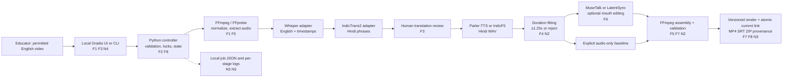

# Multilingua — Complete GenAI Project Submission

**Demo:** 18 November 2026 lab

**Scope:** English → Hindi recorded-video dubbing only

**GitHub:** https://github.com/mauryaakash-ai/Multilingua

This is the complete submission document: use case, functionality, eight-part design, architecture, technology stack, evaluation, demo examples and setup are included below. No separate Markdown document is needed to follow it.

## Project overview and functionality

Multilingua helps an educator turn a permitted English explanation into a reviewable Hindi-dubbed video. The user uploads a recording, confirms permission, checks the English transcript and edits the Hindi translation, approves it, generates Hindi speech, optionally edits mouth movement, then plays and downloads the result.

The workflow is **English video → transcription → Hindi translation → human review → Hindi speech → timing preflight → optional lip synchronization → video/subtitle export**. Outputs include MP4, Hindi SRT, reviewed text, timing, provenance and a ZIP bundle. Failed attempts preserve the previous successful result.

The team’s contribution is the model integration, review workflow, timing controls, failure handling, versioned outputs and evaluation tooling. The underlying models are pretrained; this project does not claim to have trained them. Processing is offline, not continuous realtime dubbing. Natural-looking lips and correct translation still require human inspection.

### Lab guideline coverage

| Requirement | Included here |
|---|---|
| GitHub code and shareable link | Repository link above and setup commands in section 12 |
| Use case and functionality | Overview above and section 1 |
| High-level architecture and component interactions | Embedded Mermaid diagram and explanations in section 5 |
| Tech stack, database, UI and agentic framework | Section 9 |
| Overview followed by working examples | Section 11: presentation sequence, three recording scripts and Q&A |
| Eight-part design template | Sections 1–8 |

## 1. Problem, users and success

English instructional videos are inaccessible to some Hindi-speaking learners. Subtitles help, but require reading while following visual material. Multilingua gives educators and student presenters a reviewable Hindi dub, with optional mouth editing to improve the viewing experience.

| User | Task | Success |
|---|---|---|
| Educator / creator | Adapt a short, permitted English explanation | Hindi preserves facts, names and numbers; speech is understandable |
| Bilingual reviewer | Correct translation before synthesis | Editable Hindi alongside locked source text and timestamps |
| Hindi-speaking viewer | Follow the explanation without reading continuously | Intelligible speech, consistent timing, disclosed AI editing |
| Student presenter | Explain decisions and demonstrate a complete workflow | Reproducible commands, honest measurements, recoverable failures |

Users must never receive silently truncated speech, an unnoticed audio-only substitute for failed lip sync, an old artifact presented as a new render, or an output represented as the speaker's authentic original speech. Accuracy and identity preservation are review goals, not guarantees. The prototype is unsuitable for unreviewed medical, legal, emergency or other high-stakes communication.

## 2. Why generative AI, and which kind?

The course's named “five criteria” were not supplied. **The following is an explicitly labeled working interpretation; it is not a quotation of the course framework.**

| Criterion | Application and decision |
|---|---|
| 1. Need for generated content | New Hindi utterances and mouth-region pixels cannot be produced by a fixed UI template. Generation is useful. |
| 2. Context and task suitability | A bounded language pair, timestamped phrases and constrained single-speaker clips fit pretrained specialist models. Short phrases lose context; human review is retained. |
| 3. Data and model availability | Pretrained ASR, translation, speech and lip models exist. We have no consented training corpus sufficient to justify fine-tuning. Access terms and exact revisions must be recorded. |
| 4. Error tolerance and controllability | Errors are tolerable only in a disclosed, reviewable educational draft. Text review, timing rejection and full audiovisual review are required. |
| 5. Feasibility, value and evaluation | Local offline compute can be measured against audio-only dubbing and subtitles. Human benefit must justify rendering time, setup and quality-review effort. No live-latency claim. |

**Chosen approach:** pretrained task-specific inference. Indic Parler-TTS uses a descriptive voice prompt; MuseTalk is audio-conditioned visual generation. IndicTrans2 is neural sequence-to-sequence translation, not a general chat agent. Whisper provides ASR.

**RAG: not used.** There is no external knowledge question or document corpus to retrieve; the source utterance is the content authority. A glossary could be a future controlled addition, but retrieval alone does not guarantee faithful translation.

**Fine-tuning: not used.** There is no curated consented dataset, budget or held-out evidence supporting it. **Agents: not used.** The sequence is deterministic orchestration, with no autonomous tool-selection loop. **Non-generative baseline:** original video plus reviewed Hindi subtitles. **System ablation:** same reviewed Hindi audio with original lips versus MuseTalk editing. This isolates the incremental visual benefit.

## 3. Scope and boundaries

In scope: one consenting adult with a frontal face, English speech, Hindi output; recorded clips up to 600 seconds; subtitle export; generic voice or explicitly permitted reference voice; review UI and CLI; audio fitting; lip-sync failure detection; measured offline rendering; bounded causal replay experiment.

Out of scope: webcam calls, real-time communication, overlapping/multiple speakers, diarization, arbitrary language choice, automatic speaker verification, face tracking across scene cuts, background music preservation, production hosting, multi-tenant access control, training, and automatic proof of consent.

Boundary behavior: no source audio, invalid segments or absent weights stop the job with a diagnostic. Before lip generation, speech preflight tries bounded delivery retries, an optional narrow Hindi contraction and bounded phrase-boundary redistribution. If speech still cannot fit, the reviewer must shorten it; speech is not cut off. Lip failure stops rendering; audio-only must be explicitly selected. Silence intervals retain source video and receive silence. The studio asks for another clip when no speech is detected. The experimental service and replay can return normalized original video with no-speech metadata. Fixed-window replay can split phrases; it is an experiment, not a live demo feature.

## 4. Testable requirements

| ID | Functional requirement | Verification |
|---|---|---|
| F1 | Reject missing video/audio and clips over 600 s; normalize to 25 FPS | FFmpeg integration tests + input probes |
| F2 | Produce 1–500 ordered, finite, nonoverlapping ASR phrases; one nonempty Hindi translation per phrase | Contract and timeline tests |
| F3 | UI requires permission before processing, and explicit review before rendering; only Hindi text is editable | Browser smoke + tampering tests |
| F4 | Pad short speech, accelerate at most 1.25×, reject longer speech without truncation | Audio-fit integration tests |
| F5 | Align media on absolute 25 FPS boundaries and preserve silent intervals | Timeline and FFmpeg tests |
| F6 | Produce requested mode or fail visibly; never silently switch to original lips | Positive pipeline path + deliberate failing lip-adapter tests |
| F7 | Export MP4, UTF-8 SRT, reviewed text, timing, hashes, AI disclosure and ZIP | Integration + browser download tests |
| F8 | Serialize UI model operations, lock jobs, terminate timed-out process groups, preserve the previous published render on model failure | Lock, timeout and rerender regressions |
| F9 | Missing configuration opens a useful studio and actionable system check; CLI doctor exits nonzero | UI build + diagnostics tests |

| ID | Non-functional target | Measurement / status |
|---|---|---|
| N1 Latency | UI navigation <2 s after assets load; **target** ≤10 minutes total compute for a 20 s demo clip on target hardware, excluding human review/downloads | Browser usability checked; neural compute target unmeasured here. Report cold load separately. |
| N2 Timing | Final container duration differs from normalized source by ≤120 ms | Enforced by renderer, tested synthetically; per-stage timestamps included |
| N3 Freshness | Use the exact current source and reviewed text; regenerate derived speech on every attempt | No inference-result cache; output hashes and immutable render directories |
| N4 Privacy | Localhost by default; explicitly enabled temporary demo requires login; UI upload ≤200 MB; no credentials committed | UI options, ignore rules, manual configuration review. Local adapters are trusted code. |
| N5 Retention | Gradio temporary cache eligible for cleanup after 24 h; project jobs kept until operator deletes them | Documented behavior. Delete private job directories and local browser downloads after assessment. |
| N6 Licensing | Project code MIT; record exact upstream model/code/dataset terms before sharing each demo asset | Dependency register; license review remains operator-owned |
| N7 Cost | No paid model API calls in the provided adapters; target ≤10 GPU-minutes per 20 s clip | Real timing pending. Electricity/rental/storage are not free; see cost formula below. |
| N8 Reliability | All automated checks pass; 3/3 permitted demo clips complete with no critical review failures | Software checks reported separately; real-clip gate pending |
| N9 Accessibility | Labeled native controls, visible status, keyboard navigation, Unicode Hindi, no page overflow at 390 px | Browser checks; bilingual screen-reader review still pending |

Cost per clip = GPU-hours × workstation/rental rate + CPU-hours × rate + storage/transfer cost. Record actual rates and wall time; do not substitute a guessed currency value. Assets/models may require several GB of disk and network download time.

## 5. Architecture and interactions



Optional GFPGAN restoration follows lip generation for recorded output and is OFF by default. It may invent teeth/detail and has not met the live frame budget. The same Hindi audio feeds either lip model.

The diagram above is embedded in this document and renders directly on GitHub.

The controller uses argument arrays, never a shell command string. Each model lives in a separate Python environment and receives a JSON request via `--request`; it writes a JSON response via `--response`. Heavy packages stay out of the UI environment. ASR and translation execute once per job. TTS and lip generation run per phrase. The studio launcher and optional capture service can retain supported models in resident worker processes in their compatible environments. Unsupported routes still use fresh subprocesses. Residency reduces repeated loading but does not remove neural inference cost. The controller supports next-phrase TTS prefetch when preflight is disabled; default recorded preflight checks all speech before lip generation.

The UI serializes model events across users of this local app; CLI callers must manage shared GPU capacity themselves. A per-job exclusive filesystem lock prevents competing renders. Unix process groups let timeout handling terminate nested MuseTalk processes. This release targets Linux; atomic directory symlinks are part of the publication contract.

State flow: `preparing → awaiting_review → rendering → complete`, with explicit `failed` states. Review validation happens before neural rendering. Each render gets a fresh `renders/<id>/` folder. After all outputs and the ZIP are ready, `current` switches atomically; stable output aliases resolve through it. Failed attempts keep their logs. `published_render` identifies the last successful bundle even if a later attempt fails. The job-state JSON is an operational record; `current` is the authoritative publication pointer after a process interruption.

Source timestamps are quantized once to absolute frame boundaries, avoiding accumulated rounding across cuts. Raw speech duration divided by the slot determines speed. Lips consume the fitted WAV, not the original TTS WAV. The bundle preserves the requested review times and the effective frame-aligned times. Subtitles follow the effective times. The experimental service can widen time slots only into adjacent silence.

### Temporary demo access

An explicitly requested, password-protected temporary HTTPS tunnel can expose the studio while inference stays on the local GPU. It uses a dedicated demo run directory. The tunnel provider terminates HTTPS and can access transmitted media; this is an approved single-operator demonstration, not production hosting. Credentials remain in ignored local files. Temporary access and restart instructions appear in section 12 below.

### Experimental capture service

`web/index.html` records or uploads one complete clip to a localhost FastAPI service protected by HTTP Basic authentication. The service validates permission and media limits, admits one active and one waiting GPU job, and records completion, failure or cancellation. Its worker uses the same controller with automatic translation, optional resident adapters and optional LatentSync. The service accepts only English input and generates Hindi output. Camera capture followed by processing does not provide continuous live transport.

### Deliberate decisions

- Generic Parler voice is the default to reduce reference-voice setup; identity matching is not promised.
- Review precedes synthesis so meaning changes do not require repeated expensive visual renders.
- No retrieval database, SQL database or agent framework: JSON/files cover this local workflow without unrelated infrastructure.
- Keep compatible models resident in isolated workers where supported. Default preflight prioritizes catching all speech-timing failures before expensive lip generation. Warm workers still have substantial compute costs.
- No fake success or built-in pretend demo. Fixed-text/tone adapters live only in tests.

## 6. Failure modes, guardrails and residual risk

| Failure | Guardrail / recovery | Residual risk |
|---|---|---|
| ASR hallucination / wrong names | Check source transcript; correct source segments through CLI and retranslate when needed | UI locks source text; bilingual source checking remains manual |
| Meaning reversal, number loss | Side-by-side Hindi review and explicit approval | A checkbox cannot prove reviewer competence |
| Hindi speech too long | Hard 1.25× cap; stop and shorten translation | Shortening may remove nuance; review again |
| Silent or corrupt generated WAV | Duration/media checks; adapter finite-sample checks; listen before release | Nonzero but unintelligible speech can pass automated checks |
| Missing/occluded face, wrong geometry | MuseTalk coordinate/frame/duration checks; fail visibly | Identity change, teeth artifacts and flicker need full temporal review |
| Timeout, OOM, missing access | Named logs, bounded stage timeout, process cleanup, no fallback | A killed host may leave `.render.lock`; operator must verify no active process before removal |
| Stale output / altered request | Fresh attempt paths, delete adapter outputs, validate reviewed text, protect payload fields | Disk full or process crash can interrupt publication; inspect `current` and logs |
| Model or source misuse | Permission controls, generic default voice, AI-dubbed sidecar and UI | Consent is declared, not verified. Disclosure is not a burned-in watermark; include it when sharing |
| Malicious model/config | Trusted local command arrays; revisions can be pinned | `trust_remote_code` executes upstream code; vet downloads, never accept config from strangers |
| Input decode/resource exhaustion | Duration limit, UI file limit, FFmpeg timeout, bounded UI queue | Not an adversarial upload sandbox; avoid public exposure |
| Misleading performance claim | Distinguish cold/offline RTF, replay ready delay, and actual playback latency | No human-quality or live-latency score exists until measured |

## 7. Evaluation and release gates

### Separate three kinds of evidence

1. **Software correctness:** automated tests with fixed text and synthetic tones. They verify contracts, media timing, failure handling and UI flows.
2. **Model execution:** actual ASR/translation/TTS/MuseTalk runs with recorded hardware and revisions. A successful subprocess proves execution, not quality.
3. **Human usefulness:** bilingual review, listening and continuous video inspection. No automated infrastructure test replaces this.

### Test-set slices

For the 18 November demonstration, record **three permitted 10–20 second clips**: clean explanatory speech, names/numbers, and a technical sentence. Use one frontal speaker with deliberate pauses. These are a rehearsal set, not a generalization benchmark.

For subsequent evaluation, collect at least 30 short clips from 10 consenting adults, with separate development/test speakers. Include clean English, varied Indian English accents, names/numbers, technical vocabulary, moderate noise, mild head motion and occlusion. Label non-English speech, code-switching and unsupported multi-speaker/scene-cut inputs as boundary tests, not expected successes. Never tune speed caps or acceptance thresholds on the held-out test set.

For each clip, record clip ID, speaker ID, development/test split, slice, permission reference, source SHA256, exact English transcript and human-checked Hindi reference in the evaluation manifest. Keep actual faces, consent records and references outside Git unless publication is explicitly permitted. Record exclusions with reasons before scoring, including failures; do not evaluate only successful clips.

### Per-stage metrics and proposed launch thresholds

All quality thresholds below are **targets, not measured results**.

| Stage | Metric | Demo gate / target |
|---|---|---|
| Input | Decode success; source-audio presence; duration | 100% on permitted rehearsal clips; invalid input clearly rejected |
| ASR | Word error rate against human transcript; names/numbers exact-match | Clean-speech WER ≤15%; all critical names/numbers correct after review |
| Translation | Bilingual adequacy, fluency, omissions, factual consistency | Mean adequacy ≥4/5; no critical meaning reversal or changed numbers |
| TTS | Pronunciation and naturalness 1–5; missing words; rate ratio | Mean ≥3.5/5; no missing critical words; speed ≤1.25 |
| Timing | Source/output difference; raw speech/slot ratio | ≤120 ms final duration drift; zero silently truncated phrases |
| Visual | Continuous lip alignment, identity, flicker, mouth artifacts 1–5 | Mean ≥3.5/5; no identity failure or conspicuous broken frames |
| System | Prepare/render wall time, RTF, failures, peak VRAM | 3/3 real clips complete; target ≤10 min compute per 20 s clip; no OOM |
| UI | Upload → permission → prepare → review → render → download | Browser smoke succeeds; errors recoverable; no horizontal page overflow at 390 px |

ASR WER = (substitutions + deletions + insertions) / number of reference words. State tokenization, punctuation and case normalization rules before scoring. If chrF or COMET is added, record implementation, version and Hindi reference provenance. Do not invent a score from visual inspection of text.

RTF = compute seconds / media seconds. Report prepare time plus render time, and render-only RTF separately. A ratio below 1 does not demonstrate webcam latency. Causal replay reports source-window-end-to-ready delay, not playback delay. Future streaming requires receiver-clock measurements.

### Human review protocol

Use two bilingual reviewers where available; disclose if only one is available. Compare original, subtitles-only, audio-only and lip-synced clips using the **same reviewed text and voice**. Randomize A/B order and hide mode labels during quality ratings when practical; restore disclosure for any external viewing.

Rating anchors: **1** unusable/wrong; **2** major problems; **3** understandable but noticeable problems; **4** good with minor defects; **5** faithful/natural with no observed defect. A critical failure (changed negation, wrong number, unsupported claim, unconsented identity/voice, cut-off word) overrides the average and blocks release.

Listen once without video, watch once with sound, then inspect difficult transitions. Check the first and last words, pauses, bilabial closures, teeth, facial identity and abrupt phrase joins. Record each clip’s reviewer, adequacy score, voice score, lip score, critical errors, disagreements, revisions and final approval in a review scorecard. Blank fields mean unmeasured, never zero. Have reviewers reassess after any text, voice or model change.

### Baselines and ablations

- **B0: reviewed Hindi subtitles over the original video.** Lowest compute; test whether viewers can follow speech and visuals.
- **B1: Hindi audio with original lips.** Isolates translation/TTS and exposes audiovisual mismatch.
- **B2: same Hindi audio with MuseTalk lips.** Paired comparison for added visual value.
- Later: compare raw duration mismatch to capped fitting, and fixed-window versus pause-based chunking. Do not disable the no-truncation gate merely to produce a favorable result.

Report sample size, exclusions, per-slice results, mean and range (or bootstrap confidence intervals for sufficient samples), failure rate and reviewer count. Avoid a single aggregate hiding weak slices.

### Reproducibility record

For each real run, save OS, Python, FFmpeg, GPU/driver, upstream Git commits, model revisions, package freezes, config hash, consent/source identifiers, source/output hashes, cold/warm state and measured wall times. `provenance.json` automatically captures hashes, Python and render metrics; model/driver/license evidence must be added to the operator's run record. Save `nvidia-smi` memory samples during inference for peak usage; a one-time idle query is not a peak-VRAM measurement.

The release gate is **software checks pass + real model runs + human approval**. If any leg is missing, demonstrate only what is verified and say which gate is pending.

## 8. Open questions and risks

| Question / risk | Resolution and owner | Gate |
|---|---|---|
| Model assets and recordings are intentionally absent from Git | Operator verifies the presentation computer with `doctor` and rehearses real clips; another checkout needs separate model setup | Before claiming a reproducible neural demo |
| Course's exact five criteria unknown | Presenter maps the explicitly labeled interpretation to any later supplied course wording | Before final submission |
| Gated model access / download time | Operator accepts terms on own account and tests each adapter; never commit tokens | Before live rehearsal |
| Actual compute / VRAM / clip quality | Run three clips, save metrics and human ratings; shorten demo input if necessary | Before Nov 18 presentation |
| Hindi adequacy and lip-quality thresholds are aspirational | Bilingual reviewer applies anchored rubric without tuning on held-out speakers | Before reporting quality results |
| Dataset rights and downstream publishing terms | Asset owner records source, permission, license and redistribution constraints | Before class/public distribution |
| Context loss across phrases | Evaluate pronouns/names/technical vocabulary; future context-aware grouping | Future iteration |
| Model successors may improve quality | Benchmark successors independently; preserve validated baseline for the demo | After demo, no last-minute untested swap |

## 9. Technology stack and dependencies

| Layer | Technology | Responsibility |
|---|---|---|
| Controller | Python 3.10+, standard library | State machine, validation, JSON adapter requests, locks, timing and artifacts |
| UI | Gradio 6.32, HTML/CSS | Local upload/review/playback, permission controls, progress and downloads |
| Experimental capture | FastAPI, Uvicorn, HTML/CSS/JavaScript, MediaRecorder | Authenticated local upload/capture and bounded job queue |
| Optional resident workers | Python subprocesses and Unix sockets | Retain model instances and overlap next-phrase TTS in the experimental service |
| Media | FFmpeg + FFprobe, H.264/AAC/PCM/SRT | Decode, normalize, audio fit, cut, mux, concatenate, inspect |
| ASR | faster-whisper / CTranslate2 / Whisper small.en | English transcript and phrase timestamps, CPU INT8 by default |
| Translation | AI4Bharat IndicTrans2 + IndicTransToolkit + Transformers/PyTorch | English–Hindi neural translation |
| Default speech | Indic Parler-TTS + Transformers/PyTorch + SoundFile | Prompt-described generic Hindi voice |
| Alternate speech | IndicF5 + safetensors + Transformers/PyTorch | Hindi speech conditioned on a permitted reference voice |
| Lip sync | MuseTalk 1.5 + upstream vision/audio dependencies | Audio-conditioned mouth-region editing |
| Alternate lip model | LatentSync 1.6 | Experimental GPU quality comparison |
| Optional restoration | GFPGAN 1.4 | Aligned-face restoration with feathered mouth-only paste; recorded-video experiment, OFF by default |
| Persistence | Local filesystem, JSON, ZIP | Job state, versioned renders, logs and downloadable deliverables |
| Quality checks | unittest, Ruff, Playwright, GitHub Actions | Contract/media regressions, browser workflows, lint, builds |

**No database, vector database, RAG framework, agent framework or hosted inference API is used.** This is a deterministic local pipeline. Models use isolated Python environments to avoid incompatible deep-learning dependencies. Supported models stay loaded in resident workers; fresh subprocess routes release memory when they exit.

### Sources, licensing and reproducibility

Project-authored code uses the repository's MIT license. That does not relicense upstream models, datasets, example voices or source video. Follow the linked primary sources and record the exact license files at the chosen revisions before distribution.

| Dependency / asset | Primary source | Required evidence |
|---|---|---|
| Gradio | [Repository](https://github.com/gradio-app/gradio) | Tested UI version and dependency lock |
| FFmpeg | [Official project](https://ffmpeg.org/) | Build configuration, enabled codecs and applicable distribution terms |
| faster-whisper | [Repository](https://github.com/SYSTRAN/faster-whisper) | Package/model revision, model license |
| IndicTrans2 | [Repository](https://github.com/AI4Bharat/IndicTrans2) | Model terms, revision and toolkit versions |
| Indic Parler-TTS | [Model card](https://huggingface.co/ai4bharat/indic-parler-tts) | Model access conditions, weights/code revision and tokenizer dependency |
| IndicF5 | [Model card](https://huggingface.co/ai4bharat/IndicF5) | Weights/code revision and permission for the reference voice |
| MuseTalk | [Repository](https://github.com/TMElyralab/MuseTalk) | Repo commit, v1.5 and auxiliary model terms, environment snapshot |
| LatentSync / SyncNet | [LatentSync](https://github.com/bytedance/LatentSync), [SyncNet](https://github.com/joonson/syncnet_python) | Pinned submodule revisions, model terms and checkpoint hashes |
| Input face/video and voice | Operator's own consent/source record | Capture purpose, permitted editing, class display and redistribution scope |

Model weights and generated face/voice media are not bundled in Git. Historical environment snapshots preserve the original workstation package lists. Current UI/controller dependencies are separately locked and validated. Pin remote model revisions where supported, or use explicit local snapshot directories; do not claim a moving model identifier is reproducible.

## 10. Validation evidence and remaining acceptance

Evidence is reported separately from targets. The latest software checks were run on 17 November 2026:

| Check | Observed result | Limitation |
|---|---|---|
| Python regression suite | 68 tests passed | Neural stages use test doubles; this is not Hindi/lip-quality approval |
| Node webcam harness | Passed | Checks model header, queue retry, duration and camera shutdown; not a physical webcam rehearsal |
| Ruff lint | Passed | Code checks only |
| Submission links and architecture SVG XML | Validated before consolidation | Not a user-quality score |
| Model-path diagnostics | Ready on the local workstation | Installed paths do not prove a successful new neural render |
| GPU visibility | NVIDIA RTX 2000 Ada, 16380 MiB | Idle visibility is not peak inference memory |
| Temporary public studio access | Login page HTTP 200; anonymous config HTTP 401; login succeeded; 53 authenticated UI components | Access was verified, not a complete remote generation workflow; temporary URLs can expire |

Earlier local measurements are limited experiments, not a certified final scorecard:

| Experiment | Recorded result | Interpretation |
|---|---|---|
| Resident pipeline, 5-second input | 37.350 s warm processing; RTF 7.470; TTS 3.273 s; lip adapter 31.474 s | Faster loading does not make the pipeline realtime |
| Same Hindi audio, recognizer comparison | WER 50.0% with Whisper-small versus 19.74% with large-v3 | Round-trip WER includes recognizer error and is not a direct TTS quality rating |
| GFPGAN on one 10.72-second webcam clip | SyncNet distance 8.593 → 8.368; confidence 4.691 → 4.797; added 103.10 ms/frame | One-clip alignment result; no general naturalness/sharpness claim; exceeds a 40 ms/frame live budget before lip inference |

These model measurements were recorded in earlier local experiment reports, not rerun during document preparation. Model weights, private recordings and experiment outputs are intentionally excluded from Git. A new machine must install models separately and reproduce results before treating them as its own measurements.

**Remaining gate:** rehearse three permitted clips on the presentation computer, listen to and watch each complete output, obtain fluent English–Hindi approval, and record source/output hashes, timings and model revisions. Native-speaker approval remains pending. Blank ratings mean unmeasured, not zero. Software tests and public login do not close this gate.

## 11. Demonstration walkthrough and examples

### Before class: go/no-go

- [ ] Rehearse on the actual presentation machine, projector and speakers.
- [ ] Run `python -m multilingua.cli doctor`; resolve required checks.
- [ ] Download approved weights beforehand; do not depend on classroom network access.
- [ ] Run three permitted short clips through real models. Confirm translations with a Hindi speaker.
- [ ] Listen to complete speech and watch complete lip-edited output, not just sampled frames.
- [ ] Save original, audio-only and lip-synced versions outside temporary upload storage; open each locally.
- [ ] Record actual timings, model revisions, source permissions and reviewer signoff.
- [ ] Keep the repository, README, design diagram and evaluation record ready in browser tabs.
- [ ] Silence notifications; check projector text size and audio volume.

**Current status (17 November):** model-path diagnostics pass on the local GPU workstation. The password-protected temporary studio link has passed public login and anonymous-access checks. These checks do not prove a complete neural render. Rehearse the three clips below and inspect their saved outputs before class; native-speaker approval remains pending. Model weights, credentials and private recordings are intentionally excluded from Git. Use localhost if the temporary link expires.

### Timed presentation

| Time | Presenter action | Key message |
|---|---|---|
| 0:00–1:30 | State problem, user and one use case; show repo | “We help educators adapt a short English explanation for Hindi-speaking learners.” |
| 1:30–3:00 | Show architecture; identify model roles and human checkpoint | “Generation handles speech and mouth pixels; a person controls meaning.” |
| 3:00–4:00 | Explain GenAI choice, scope and baseline | Pretrained specialist models; no RAG or fine-tuning; recorded video only |
| 4:00–6:00 | Upload a short clip, confirm permission, prepare, show/edit one Hindi phrase | Explain why numbers/names and translation length matter |
| 6:00–8:00 | Generate audio-only or lip mode if rehearsed runtime fits; show progress | Report measured loading and inference time separately; both can contribute to the delay. Do not wait indefinitely. |
| 8:00–10:00 | Play saved original, audio-only and lip-edited versions from the same real run | Identify mode explicitly; show subtitles, artifacts and measured time |
| 10:00–12:00 | Show one controlled failure and evaluation evidence | Too-long speech stops rather than silently truncating; distinguish tests from quality ratings |
| 12:00–15:00 | Audience Q&A | Answer with evidence, acknowledge limits, offer a concrete next experiment |

If generation exceeds the rehearsed window, switch to a **previously rendered real output** and say so. Do not relabel precomputed results as live inference. If no real output exists, explain the model-access gap and show the verified UI/tests; this remains an incomplete neural demo.

### Suggested recording scripts

Record these yourself or with a consenting teammate, using natural pauses. These Hindi lines are draft examples and still need bilingual review.

1. **Everyday explanation:** “Good morning. Today we will learn how computers translate language. Please listen to the original video first.”
   Draft: “सुप्रभात। आज हम सीखेंगे कि कंप्यूटर भाषा का अनुवाद कैसे करते हैं। पहले मूल वीडियो सुनिए।”
2. **Numbers and negation:** “The workshop starts at ten, not eleven. Bring two notebooks. Registration is free.”
   Draft: “कार्यशाला दस बजे शुरू होती है, ग्यारह बजे नहीं। दो नोटबुक लाएँ। पंजीकरण निःशुल्क है।”
3. **Technical vocabulary:** “A model learns patterns from examples. We review its translation before generating the final video.”
   Draft: “मॉडल उदाहरणों से पैटर्न सीखता है। अंतिम वीडियो बनाने से पहले हम उसके अनुवाद की जाँच करते हैं।”

Use 10–20 seconds, steady framing, bright diffuse light, no background music, a visible unobstructed mouth and an extra pause at each end. Never imply the generic voice clones the source speaker.

### Q&A practice

**Why not subtitles alone?** They are our lowest-cost baseline. Dubbing reduces reading burden; lip editing should earn its additional compute through better viewing experience. We plan paired user ratings.

**Is it real time?** No. The studio processes recorded clips and keeps supported models resident; some adapters still use separate processes. The optional webcam service finalizes a recording before processing it. Warm workers reduce loading time, while continuous low-latency dubbing still requires measurement.

**Why no RAG or agent framework?** The source speech supplies the content. This is a fixed media transformation workflow, not external knowledge retrieval or autonomous planning.

**What is your contribution?** A reviewable integration: adapters across isolated environments, bounded duration fitting, explicit failures, coherent render artifacts, a review UI and reproducible evaluation. We did not train the underlying models.

**What if Hindi is longer than English?** We measure generated speech. Up to 1.25× acceleration is allowed. Bounded delivery retries and phrase-timing adjustments may help; a narrow Hindi contraction is logged as an automatic edit. If speech still does not fit, a shorter, meaning-preserving translation is required. The video is not extended and speech is not truncated.

**How do you measure quality?** ASR reference errors, bilingual adequacy, speech naturalness, temporal lip/identity inspection, timing drift and runtime. Report only measured results, with sample size and reviewer count.

**What can fail?** Accent recognition, names, code-switching, missing faces, flicker and model access. Point to one observed failure and the applicable guardrail.

**What happens to my video?** It is processed through local adapters. Downloading weights requires network access during setup. Jobs remain on disk until deleted. The optional password-protected demo link carries uploads through its tunnel provider to this computer; share only permitted media. It is not a multi-user production service.

**What would you improve next?** Validate the existing sentence grouping and persistent workers on held-out speakers, then improve Hindi delivery and mouth quality. Live transport comes only after clocked scheduling and sustained latency measurements.

### Team handoffs

For three presenters: A owns problem/design (0–4 min), B owns demonstration (4–10 min), C owns evaluation/risks (10–12 min); everyone answers their component's questions. Rehearse the handoff sentence and cap answers at 30–45 seconds before inviting follow-up. With fewer presenters, keep the same timing and allocate roles explicitly.

## 12. Setup, access and submission handover

### Local studio

```bash
git clone https://github.com/mauryaakash-ai/Multilingua.git
cd Multilingua
# Ubuntu prerequisite: ffmpeg and python3-venv
python3 -m venv .venv
source .venv/bin/activate
pip install -e '.[ui,server,dev]'
cp configs/local.example.json configs/local.json
# Install approved model weights and their isolated environments.
# Update configs/local.json to the actual model, repository and Python paths.
python -m multilingua.cli --config configs/local.json doctor
python -m multilingua.cli --config configs/local.json ui
```

Open `http://127.0.0.1:7860`. Installing the controller package alone does not install model weights or heavy model environments. The example configuration describes the expected adapters. Complete gated-model access using your own account, keep tokens out of Git, and run `doctor` before inference. The default voice is generic Hindi; reference-voice synthesis requires permission and matching reference audio/text.

### CLI workflow and artifacts

```bash
python -m multilingua.cli --config configs/local.json prepare /absolute/input.mp4
# Review and edit Hindi in the job's segments.json.
python -m multilingua.cli --config configs/local.json render runs/JOB_ID --audio-only
python -m multilingua.cli --config configs/local.json render runs/JOB_ID
```

Each attempt has its own `runs/JOB_ID/renders/RENDER_ID` directory. After success, the atomic `current` link identifies the published output and matching metadata. Exported `delivery.zip` contains video, subtitles, reviewed text, timing and provenance. Keep this bundle and original media ready locally for the demonstration; do not rely on the classroom network for inference dependencies.

### Temporary password-protected access

The temporary demo uses this computer’s GPU and a dedicated `runs/public-demo` directory. Its username and password are stored locally in `.runtime/demo-login.json`; never put them in this submission or a public repository. It is a single-operator demo, not a multi-tenant service. Anyone given its login can access that demo’s results.

Stop any app already using port 7860, then start the authenticated studio and approved external tunnel in separate terminals:

```bash
python scripts/serve_demo.py --no-share
```

```bash
ssh -o ServerAliveInterval=30 -R 80:127.0.0.1:7860 nokey@localhost.run
```

Use the HTTPS URL printed by SSH. Keep both processes running and the computer awake. Stop SSH with Ctrl+C to remove public access. The URL may rotate or expire. The operator approved localhost.run for this temporary demo; it terminates HTTPS and can access transmitted credentials/media, so use the dedicated demo login and only permitted footage. Localhost remains the fallback if the tunnel fails. This is not permanent production hosting.

### Software checks

```bash
ruff check .
ruff format --check .
python -m unittest discover -s tests -v
node tests/webcam_backpressure.cjs
python -m build
# Requires installed Playwright Chromium or a compatible Chrome setup:
python tests/browser_smoke.py
```

Heavy neural inference is excluded from synthetic CI checks. Record hosted CI status separately; a local pass does not establish that GitHub Actions ran.

### Presentation handover checklist

- Share the GitHub link and this single document with the evaluator.
- Show the embedded architecture and explain model responsibilities.
- Prepare three permitted source clips and their real saved outputs; label any precomputed playback.
- Keep exact English transcripts, reviewed Hindi, source/output hashes and timing records with the outputs.
- Keep credentials, weights, private recordings and consent records out of public Git.
- State pending human approval and offline processing honestly; do not claim continuous realtime operation.
