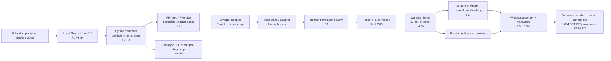

# Multilingua — design and architecture

**Release:** English → Hindi recorded-video dubbing, local single-operator prototype.
**Demo:** 18 November 2026. **Decision status:** implemented baseline; model-quality acceptance remains pending on the presentation workstation.

## 1. Problem, users and success

English instructional videos are inaccessible to some Hindi-speaking learners. Subtitles help, but require reading while following visual material. Multilingua gives educators and student presenters a reviewable Hindi dub, with optional mouth editing to improve the viewing experience.

| User | Task | Success |
|---|---|---|
| Educator / creator | Adapt a short, permitted English explanation | Hindi preserves facts, names and numbers; speech is understandable |
| Bilingual reviewer | Correct translation before synthesis | Editable Hindi alongside locked source text and timestamps |
| Hindi-speaking viewer | Follow the explanation without reading continuously | Intelligible speech, consistent timing, disclosed AI editing |
| Student presenter | Explain decisions and demonstrate a complete workflow | Reproducible commands, honest measurements, recoverable failures |

Users must never receive silently truncated speech, an unnoticed audio-only substitute for failed lip sync, an old artifact presented as a new render, or an output represented as the speaker's authentic original speech. Accuracy and identity preservation are review goals, not guarantees. The prototype is unsuitable for unreviewed medical, legal, emergency or other high-stakes communication.

## 2. Why generative AI, and which kind?

The course's named “five criteria” were not supplied. **The following is an explicitly labeled working interpretation, approved for this document; it is not a quotation of the course framework.**

| Criterion | Application and decision |
|---|---|
| 1. Need for generated content | New Hindi utterances and mouth-region pixels cannot be produced by a fixed UI template. Generation is useful. |
| 2. Context and task suitability | A bounded language pair, timestamped phrases and constrained single-speaker clips fit pretrained specialist models. Short phrases lose context; human review is retained. |
| 3. Data and model availability | Pretrained ASR, translation, speech and lip models exist. We have no consented training corpus sufficient to justify fine-tuning. Access terms and exact revisions must be recorded. |
| 4. Error tolerance and controllability | Errors are tolerable only in a disclosed, reviewable educational draft. Text review, timing rejection and full audiovisual review are required. |
| 5. Feasibility, value and evaluation | Local offline compute can be measured against audio-only dubbing and subtitles. Human benefit must justify rendering time, setup and quality-review effort. No live-latency claim. |

**Chosen approach:** pretrained task-specific inference. Indic Parler-TTS uses a descriptive voice prompt; MuseTalk is audio-conditioned visual generation. IndicTrans2 is neural sequence-to-sequence translation, not a general chat agent. Whisper provides ASR.

**RAG: not used.** There is no external knowledge question or document corpus to retrieve; the source utterance is the content authority. A glossary could be a future controlled addition, but retrieval alone does not guarantee faithful translation.

**Fine-tuning: not used.** There is no curated consented dataset, budget or held-out evidence supporting it. **Agents: not used.** The sequence is deterministic orchestration, with no autonomous tool-selection loop. **Non-generative baseline:** original video plus reviewed Hindi subtitles. **System ablation:** same reviewed Hindi audio with original lips versus MuseTalk editing. This isolates the incremental visual benefit.

## 3. Scope and boundaries

In scope: one consenting adult with a frontal face, English speech, Hindi output; recorded clips up to 600 seconds; subtitle export; generic voice or explicitly permitted reference voice; review UI and CLI; audio fitting; lip-sync failure detection; measured offline rendering; bounded causal replay experiment.

Out of scope: webcam calls, real-time communication, overlapping/multiple speakers, diarization, arbitrary language choice, automatic speaker verification, face tracking across scene cuts, background music preservation, production hosting, authentication, training, and automatic proof of consent.

Boundary behavior: no source audio, no speech, invalid segments or absent weights stop the job with a diagnostic. If Hindi speech exceeds the allowed duration ratio, the reviewer must shorten it. Lip failure stops rendering; audio-only must be explicitly selected. Silence intervals retain source video and receive silence. Fixed-window replay can split phrases and rejects silent chunks; it is an experiment, not a live demo feature.

## 4. Testable requirements

| ID | Functional requirement | Verification |
|---|---|---|
| F1 | Reject missing video/audio and clips over 600 s; normalize to 25 FPS | FFmpeg integration tests + input probes |
| F2 | Produce 1–500 ordered, finite, nonoverlapping ASR phrases; one nonempty Hindi translation per phrase | Contract and timeline tests |
| F3 | UI requires permission before processing, and explicit review before rendering; only Hindi text is editable | Browser smoke + tampering tests |
| F4 | Pad short speech, accelerate at most 1.25×, reject longer speech without truncation | Audio-fit integration tests |
| F5 | Align media on absolute 25 FPS boundaries and preserve silent intervals | Timeline and FFmpeg tests |
| F6 | Produce requested mode or fail visibly; never silently switch to original lips | Positive pipeline path + deliberate failing lip-adapter tests |
| F7 | Export MP4, UTF-8 SRT, reviewed text, timing, hashes, AI disclosure and ZIP | Integration + browser download tests |
| F8 | Serialize UI model operations, lock jobs, terminate timed-out process groups, preserve the previous published render on model failure | Lock, timeout and rerender regressions |
| F9 | Missing configuration opens a useful studio and actionable system check; CLI doctor exits nonzero | UI build + diagnostics tests |

| ID | Non-functional target | Measurement / status |
|---|---|---|
| N1 Latency | UI navigation <2 s after assets load; **target** ≤10 minutes total compute for a 20 s demo clip on target hardware, excluding human review/downloads | Browser usability checked; neural compute target unmeasured here. Report cold load separately. |
| N2 Timing | Final container duration differs from normalized source by ≤120 ms | Enforced by renderer, tested synthetically; per-stage timestamps included |
| N3 Freshness | Use the exact current source and reviewed text; regenerate derived speech on every attempt | No inference-result cache; output hashes and immutable render directories |
| N4 Privacy | Localhost binding; no public share; UI upload ≤200 MB; no credentials committed | UI options, ignore rules, manual configuration review. Local adapters are trusted code. |
| N5 Retention | Gradio temporary cache eligible for cleanup after 24 h; project jobs kept until operator deletes them | Documented behavior. Delete private job directories and local browser downloads after assessment. |
| N6 Licensing | Project code MIT; record exact upstream model/code/dataset terms before sharing each demo asset | Dependency register; license review remains operator-owned |
| N7 Cost | No paid model API calls in the provided adapters; target ≤10 GPU-minutes per 20 s clip | Real timing pending. Electricity/rental/storage are not free; see cost formula below. |
| N8 Reliability | All automated checks pass; 3/3 permitted demo clips complete with no critical review failures | Software checks reported separately; real-clip gate pending |
| N9 Accessibility | Labeled native controls, visible status, keyboard navigation, Unicode Hindi, no page overflow at 390 px | Browser checks; bilingual screen-reader review still pending |

Cost per clip = GPU-hours × workstation/rental rate + CPU-hours × rate + storage/transfer cost. Record actual rates and wall time; do not substitute a guessed currency value. Assets/models may require several GB of disk and network download time.

## 5. Architecture and interactions

A static [architecture figure](assets/architecture.svg) is also available for projection.

The controller uses argument arrays, never a shell command string. Each model lives in a separate Python environment and receives a JSON request via `--request`; it writes a JSON response via `--response`. Heavy packages stay out of the UI environment. ASR/translation execute once per job; TTS/lip sync execute once per phrase. Process isolation releases GPU memory but repeats model loading. This tradeoff favors a predictable offline baseline over low latency.

The UI serializes model events across users of this local app; CLI callers must manage shared GPU capacity themselves. A per-job exclusive filesystem lock prevents competing renders. Unix process groups let timeout handling terminate nested MuseTalk processes. This release targets Linux; atomic directory symlinks are part of the publication contract.

State flow: `preparing → awaiting_review → rendering → complete`, with explicit `failed` states. Review validation happens before neural rendering. Each render gets a fresh `renders/<id>/` folder. After all outputs and the ZIP are ready, `current` switches atomically; stable output aliases resolve through it. Failed attempts keep their logs. `published_render` identifies the last successful bundle even if a later attempt fails. The job-state JSON is an operational record; `current` is the authoritative publication pointer after a process interruption.

Source timestamps are quantized once to absolute frame boundaries, avoiding accumulated rounding across cuts. Raw speech duration divided by the slot determines speed. Lips consume the fitted WAV, not the original TTS WAV. Hindi subtitles preserve reviewed phrase times (within half a frame of fitted boundaries).

### Deliberate decisions

- Generic Parler voice is the default to reduce reference-voice setup; identity matching is not promised.
- Review precedes synthesis so meaning changes do not require repeated expensive visual renders.
- No retrieval database, SQL database or agent framework: JSON/files cover this local workflow without unrelated infrastructure.
- Per-phrase models and no persistent GPU worker: easy isolation, slower cold loads. Record this limitation in the demo.
- No fake success or built-in pretend demo. Fixed-text/tone adapters live only in tests.

## 6. Failure modes, guardrails and residual risk

| Failure | Guardrail / recovery | Residual risk |
|---|---|---|
| ASR hallucination / wrong names | Check source transcript; correct source segments through CLI and retranslate when needed | UI locks source text; bilingual source checking remains manual |
| Meaning reversal, number loss | Side-by-side Hindi review and explicit approval | A checkbox cannot prove reviewer competence |
| Hindi speech too long | Hard 1.25× cap; stop and shorten translation | Shortening may remove nuance; review again |
| Silent or corrupt generated WAV | Duration/media checks; adapter finite-sample checks; listen before release | Nonzero but unintelligible speech can pass automated checks |
| Missing/occluded face, wrong geometry | MuseTalk coordinate/frame/duration checks; fail visibly | Identity change, teeth artifacts and flicker need full temporal review |
| Timeout, OOM, missing access | Named logs, bounded stage timeout, process cleanup, no fallback | A killed host may leave `.render.lock`; operator must verify no active process before removal |
| Stale output / altered request | Fresh attempt paths, delete adapter outputs, validate reviewed text, protect payload fields | Disk full or process crash can interrupt publication; inspect `current` and logs |
| Model or source misuse | Permission controls, generic default voice, AI-dubbed sidecar and UI | Consent is declared, not verified. Disclosure is not a burned-in watermark; include it when sharing |
| Malicious model/config | Trusted local command arrays; revisions can be pinned | `trust_remote_code` executes upstream code; vet downloads, never accept config from strangers |
| Input decode/resource exhaustion | Duration limit, UI file limit, FFmpeg timeout, bounded UI queue | Not an adversarial upload sandbox; avoid public exposure |
| Misleading performance claim | Distinguish cold/offline RTF, replay ready delay, and actual playback latency | No human-quality or live-latency score exists until measured |

## 7. Evaluation and release gates

See [EVALUATION.md](EVALUATION.md) for slices, per-stage metrics, thresholds, the review rubric and a machine-readable manifest template. Software tests establish orchestration correctness; they do not establish ASR, Hindi, voice or lip quality. A real release requires bilingual human signoff and uninterrupted full-video viewing on three permitted clips.

## 8. Open questions and risks

| Question / risk | Resolution and owner | Gate |
|---|---|---|
| Original model assets and demo media are inaccessible | Model operator installs/downloads approved revisions or recovers permitted assets; record hashes | Before claiming a working neural demo |
| Course's exact five criteria unknown | Presenter maps the explicitly labeled interpretation to any later supplied course wording | Before final submission |
| Gated model access / download time | Operator accepts terms on own account and tests each adapter; never commit tokens | Before live rehearsal |
| Actual compute / VRAM / clip quality | Run three clips, save metrics and human ratings; shorten demo input if necessary | Before Nov 18 presentation |
| Hindi adequacy and lip-quality thresholds are aspirational | Bilingual reviewer applies anchored rubric without tuning on held-out speakers | Before reporting quality results |
| Dataset rights and downstream publishing terms | Asset owner records source, permission, license and redistribution constraints | Before class/public distribution |
| Context loss across phrases | Evaluate pronouns/names/technical vocabulary; future context-aware grouping | Future iteration |
| Model successors may improve quality | Benchmark successors independently; preserve validated baseline for the demo | After demo, no last-minute untested swap |
